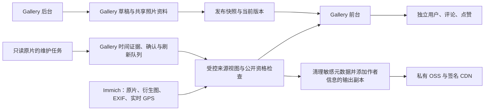

# 架构、数据边界与产品约定

这是已实现行为的接手摘要。具体边界以相关 ADR、数据字典和代码为依据；新增需求仍由用户确认。完整历史索引见[文档首页](../README.md)。

## 一、系统关系

- 这是 Immich fork 上的独立 Gallery，不是 Immich 相册的皮肤。Gallery 相册跨 Immich 相册选片；不能增加“每本 Gallery 相册只能对应一本 Immich 相册”的外键。
- PostgreSQL 同库：Immich 使用上游结构，Gallery 使用 `gallery` schema。Gallery 的运行角色不能写 Immich 表；新的 Gallery 迁移必须同步数据字典，不能改写已执行迁移。
- 用户、相册、图片组、文章都有各自的业务身份。前台访客、后台管理员、Immich 用户、数据库角色是四类不同身份，不能混用。
- 图片标题、说明、标签与选择范围按发布快照公开；GPS 从 Immich 当前记录读取，不固化进 release。下线、来源停用、资产删除等必须立即收紧资格。
- 原片、Immich thumbnail 和 preview 都不允许为 Gallery 功能原地改写。业务关联不因元数据输出、时区校正或 CDN 更新而换 ID。

## 二、代码定位

| 功能 | 主要代码入口（相对仓库根目录） | 决策与说明 |
|---|---|---|
| 类型与纯算法 | `packages/gallery-core/src/` | 地点、时间、富文本、地图等算法在此，不引入数据库 |
| 数据库和服务 | `packages/gallery-db/src/*.server.ts`，`entry.server.*` | [数据库](../architecture/database.md)、[发布](../architecture/publication.md) |
| 相册、照片资料、列表 | `albums.server.ts`、`shared-photos.server.ts`、`photo-library.server.ts`、`feed.server.ts` | ADR 0004、0005、0010、0020 |
| 图片授权、输出、CDN | `media.server.ts`、`image-metadata.server.ts`、`image-attribution.server.ts`、`cdn.server.ts` | [作者信息](../architecture/media-attribution.md)、[画质](../decisions/0008-immich-image-quality.md) |
| 地点与地图 | `places.server.ts`、`countries.server.ts`、`regions.server.ts`、`map.server.ts`、`visited.server.ts` | [地点](../architecture/places.md)、[到访](../architecture/visited-map.md)、ADR 0018/0021 |
| 拍摄时间 | core 的 `capture-time/evidence/state/review/reuse.ts`；db 的 `capture.server.ts`、`capture-refresh.server.ts` | [拍摄时间](../architecture/capture-time.md)、ADR 0024–0028 |
| 时间采集维护 | `deployment/gallery/scripts/collect-capture-evidence.cjs`；`cloud/capture/`；db `scripts/capture-*.ts` | [读取任务说明](../../../deployment/gallery/cloud/capture/README.md) |
| 文章 | `articles.server.ts`、`article-media.server.ts`；admin `src/lib/articles/`；ui `src/articles/` | [文章](../architecture/articles.md)、ADR 0012/0013/0016 |
| 用户和互动 | `member.server.ts`、`community.server.ts`、`community-mail.server.ts`；ui `src/community/` | [数据字典](../architecture/community.md)、[ADR 0023](../decisions/0023-members-comments-and-likes.md) |
| 共享界面 | `packages/gallery-ui/src/Gallery.svelte`、`PublicFrame.svelte`、`SearchField.svelte`、`SegmentedControl.svelte` 等 | 先复用现有组件，不为每项新功能设计不同样式 |
| 后台入口 | `packages/gallery-admin/src/routes/`，`src/lib/Manager.svelte` 等 | 服务端载入和动作在 `+page.server.ts` / `+server.ts` |
| 前台入口 | `packages/gallery-public/src/routes/` | `/albums`、`/photos`、`/visited`、`/records`、`/about`、`/account` |
| 迁移与运行 | `packages/gallery-db/migrations/`；`deployment/gallery/`；`.github/workflows/gallery.yml` | [运维指南](production-operations.md) |

数据库代码只从显式 server-only 入口导入。不要把连接工厂移到组件、共享客户端模块或通用 `+page.ts`。五个包中的 core/db/ui 是源代码包；public/admin 使用 SvelteKit adapter-node 生成运行服务，不是复制一个静态 build 目录就能独立恢复所有依赖。

## 三、访问权限和发布

**授权不是“知道照片 ID 就能看”。** 请求须经过来源所有者白名单、资产状态、当前 release 成员、发布祖先链、位置策略、媒体路径和文件存在性检查。缓存命中、文章引用、照片直链、互动接口都不能绕过。

- 相册单父级，可以同时有直接照片和子相册；详情默认不铺开所有后代照片。
- 发布自顶向下；祖先下线会阻断后代。首次发布后的 slug 稳定，改标题/移动不重建地址。
- 一个 Immich asset 在 Gallery 中共用一份照片资料，多相册引用共享资料；照片组有自己的顺序和封面，不应为展示副本重复建业务照片。
- 文章发布的照片可以只在文章上下文公开，不因此进入所有相册/相片列表。后台核验链接优先相册，其次已发布文章定位到图，最后后台入口。
- 原图不对 Gallery 公共容器开放；公开媒体只输出允许的衍生图，不在衍生文件缺失时退回原图。
- `gallery_public` 负责只读展示，`gallery_community` 负责有限互动读写，`gallery_admin` 负责后台业务；`gallery_migrator` 和 NOLOGIN 的 `gallery_view_owner` 属于维护/视图边界，不给运行服务 owner 权限。

## 四、拍摄时间：最容易丢失的上下文

必须区分三个量：**相机记录的钟表时间、实际 UTC 时刻、拍摄地点当时的时区**。经纬度能提供地点时区，不能证明机身钟表设成了哪个时区；Immich 显示一个时间也不必然代表原片含有完整时区证据。

| 证据/情形 | 当前处理原则 |
|---|---|
| 原始时间有可信 UTC 偏移，且有有效地点 | 先取得 UTC 时刻，再用地点 IANA 时区按拍摄日期换算 |
| 有有效 GPS UTC、位置和相机钟表，且证据相互吻合 | 校验后自动换算；不能只因“某型号有 GPS”就视为可靠 |
| 相机时间存在但缺少可信偏移，GPS 也不能佐证时刻 | 允许人工确认“相机当时用 UTC+08:00”等，再按地点换算 |
| 有相机时间但没有可用 GPS | 保留相机记录时间展示，明确时区未定；不能捏造所在地或自动套服务器时区 |
| 地点时区确实缺失且用户明确知道 | 独立确认地点时区，不与相机时区混为一个字段 |
| 只补 GPS、时间证据未变，已有有效人工确认 | 重读后复用相机时区确认，按新地点换算，不要求重复确认 |
| 原始时间改变、时间证据冲突、停用或旧基线无法证明 | 不复用旧确认；之后再次补 GPS 也不能复活它 |
| 读取排队/进行中 | “正在更新拍摄时间”，与人工待核对分开；完成后列表自动刷新 |

用户通常把 Canon EOS 5D Mark IV 和 Sony A7CR 设成北京时间。佳能某批有 GPS UTC、部分缺少有效信号；索尼某批有明确时间偏移，GPS 后补。**这些是排查线索，不是按相机型号写死规则的授权。** 未来其他相机按证据走相同体系。

2017 年约旦的示例是北京时间 `18:21:37` 对应当地 `12:21:37`。使用拍摄当天的历史 IANA 规则，不能用约旦今天的偏移硬减。源照片日期看起来在未来，也不能仅凭当前日期自行更正。

采集任务只读 Immich 原片/sidecar/源数据库，将证据写进 Gallery；人工确认、停用、自动结果和审计也只在 Gallery。0016 存证据和校正，0017 存重新读取队列，0018 增加独立时间签名。前台和到访按解析后的时间使用一致语义，缺证据不应展示成已确认的“当地时间”。

后台可见页空闲轮询约 15 秒，处理中约 2.5 秒，回到窗口立即检查；隐藏页、输入弹窗或提交期间避免刷新抢操作。生产任务每约 15 秒处理队列，全量扫描间隔约 10 分钟，时间不是实时保证，错误要单独可见和重试。

## 五、地点、旅行和连续浏览

- 地点选择默认仅展开国家，点箭头逐级展开省州、城市；选中上级包含下属照片，展开和选择是不同操作。搜索匹配后展开相关路径。
- 国家无法识别比城镇名称缺失严重，两者在后台分开；不能把“海岸附近无城市”与“无法归属国家”混成一个数字。
- 世界地图与中国省份地图均为抽象形状；用“去过”“尚未留下照片”，不改成“已点亮”。地区结构可扩展到其他国家，但新增地图须另行设计验收。
- 到访按公开照片位置及当地日期派生。前台展示旅行日期并按旅行时间排序；后台先按国家/省份名称排列，方便发现同地多段。
- 人工合并/拆分/改日期的到访保留人工成员边界。新补照片形成自动段并不代表整理失效；用户可显式合并，不能偷偷改人工记录。
- 相册、相片支持向下自动加载、失败重试、图片占位、直链及返回位置恢复。不得为新功能退回繁琐分页，也不能丢失筛选状态或照片锚点。

## 六、作者信息与 OSS

创作者和主页均为 `https://vision.ke`。输出时向 Gallery 展示副本加入 EXIF Artist、XMP creator 和 IPTC Core 主页信息，仍按规则清除不应公开的源元数据。不是修改 Immich thumbnail/preview；JPEG 输出避免重复压缩，保留原有像素和颜色配置。

只对进入 Gallery 公开范围的照片生成 OSS 副本，Immich 中未选入 Gallery 的照片不预先公开。内容变化生成对应的新内容版本对象，业务照片 ID、相册和文章关联不变；重复同步应幂等。旧对象按撤销/回收策略处理，不为“去重”直接清空 Bucket。独立文章上传图不是自动纳入相机照片作者策略的同一来源。

OSS 私有，CDN 使用短期签名；源站私有读取、允许清单新鲜度和授权检查共同控制撤销。不能把签名链接或已知对象名变成永久公开授权。完整设计见[作者信息](../architecture/media-attribution.md)、[OSS 交付](../delivery/oss-cdn.md)。

## 七、用户与互动及前台样式

- 邮箱唯一，展示名称不唯一；邮箱验证码注册/登录，无密码。未注册邮箱登录应明确提示；验证码只存在受控发信/验证路径，日志不输出。
- 自动分配稳定几何头像，允许重新随机，不允许用户上传头像；修改邮箱验证旧、新邮箱。会话长期有效（当前 180 天滑动），退出/禁用/改绑等撤销会话。
- 评论为纯文字，当前 1–1000 字；有待审核/公开/隐藏/删除状态，新用户审核后 trusted；后台可回复，前台不扩展成复杂社交系统。
- 后台分别控制注册、新评论、新点赞、历史评论展示、点赞展示。关闭历史展示不删除历史数据。注册关闭后既有用户仍可登录；“暂停新增互动”的重复快捷按钮已移除。
- 专项反机器人设计按用户要求延期；保留验证码有效期、重发间隔、验证次数和会话/权限校验，不等于移除基础校验。
- 相册点赞与评论分开：详情标题附近的点赞；说明后的评论栏；无说明且无评论时收起空栏并保留轻量入口。有说明无评论时不显示空提示或“评论 0”。
- 相片浮动点赞独立于信息栏；“照片信息”只展示元数据，“评论”标签放说明和评论。输入默认是小型入口，点击才展开，发完收起。
- 文章评论与正文对齐、最早评论在上，发表评论入口在底部；评论不做无意义显示/隐藏切换。文章点赞界面暂时隐藏，底层保留。
- 列表里的零赞不显示图标和数字；相册列表有赞时与“共 xx 张照片”同一行靠右。实际点赞入口仍允许为零赞照片送出第一个赞。
- 全站保持既有留白、字体、低饱和绿色、搜索框、排序和标签样式。移动端图片与信息区域不得互相遮挡。避免后台式的大表单和每个新功能一套新视觉语言。

相关文章编辑器的表格操作栏应随工具栏吸顶；长文章保存失败必须可见且说明原因。曾出现响应式对象 `structuredClone` 报错，不能用吞掉异常/清空草稿掩盖；改保存逻辑须检验长文、表格和未保存内容保护。
